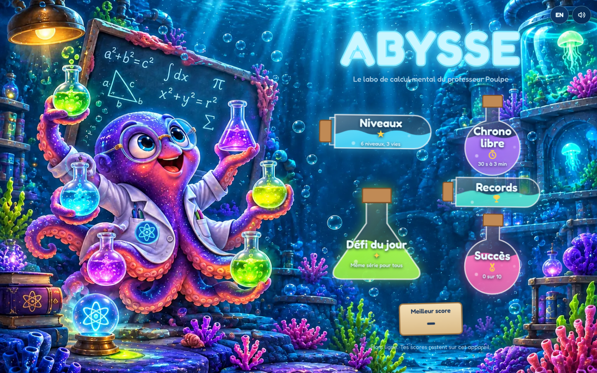
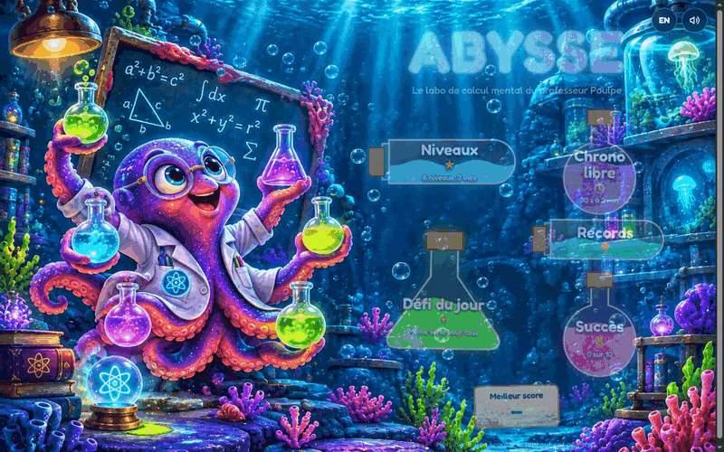
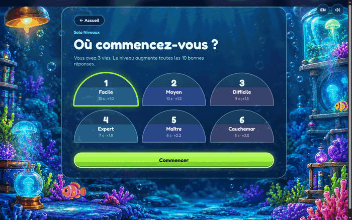
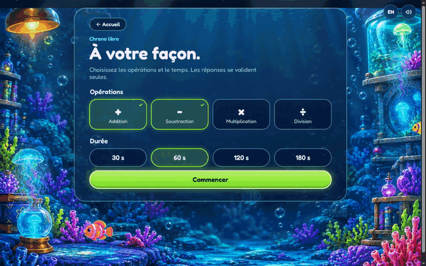
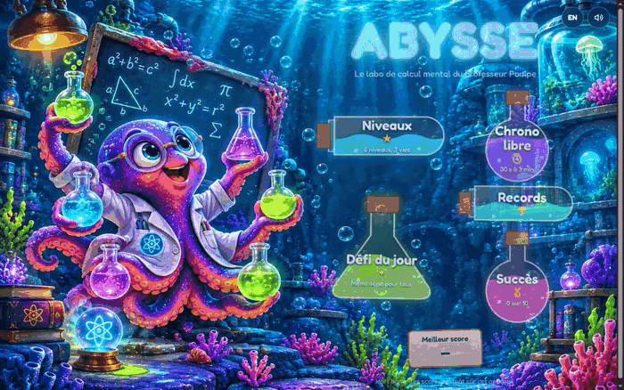

# ABYSSE — le labo de calcul mental

<p align="center">
  
</p>

Un jeu de calcul mental immersif, à jouer seul, en français ou en anglais. Vos parties et records restent dans votre navigateur.

## Aperçu

<table>
  <tr>
    <td align="center"><strong>Accueil</strong><br></td>
    <td align="center"><strong>Niveaux</strong><br></td>
  </tr>
  <tr>
    <td align="center"><strong>Chrono libre</strong><br></td>
    <td align="center"><strong>Défi du jour</strong><br></td>
  </tr>
</table>

<p align="center">
  <strong>Sur mobile — interface en anglais</strong><br>
  
</p>

## Modes de jeu

### Niveaux

- Choisissez l’un des six niveaux : de **Facile** (12 secondes par question) à **Cauchemar** (5 secondes).
- Vous avez **3 vies** ; une erreur ou un délai dépassé en coûte une. Le niveau augmente toutes les 10 bonnes réponses, jusqu’au niveau 6.
- Une bonne réponse rapporte **150 points** en moins de 3 secondes, **100** en moins de 6 secondes, sinon **50**. Le score final est multiplié selon le niveau de départ.

### Chrono libre

- Choisissez les opérations (**+**, **−**, **×**, **÷**) et une durée de **30, 60, 120 ou 180 secondes** ; le chrono et le score restent toujours visibles.
- Une réponse juste passe immédiatement à la question suivante. **Passer** — ou la barre d’espace — affiche une nouvelle question sans changer le score ni la précision.
- Les records sont conservés par durée et combinaison d’opérations ; les résultats indiquent aussi la précision, les questions passées et la meilleure série.

### Défi du jour

- Répondez à **20 questions identiques pour tout le monde le même jour**, avec 3 vies. La série progresse par quatre questions aux niveaux 2, 3, 4, 5 puis 6.
- Les points dépendent de la vitesse, comme en mode Niveaux. Une erreur ou un délai dépassé fait avancer la série et coûte une vie.
- Seule une partie **terminée** est comptée pour la journée : quitter en cours de route permet de réessayer. Le résultat peut être partagé.

## Fonctionnalités

- Interface en français et en anglais, avec langue mémorisée dans le navigateur.
- Sons synthétisés activables ou non, compte à rebours avant chaque partie et badges de combo.
- Succès, records et historique conservés localement ; partage du résultat quotidien.
- Pensé pour jouer sans compte ni service distant : aucune API de jeu, progression stockée dans le navigateur.
- Interface responsive et pavé numérique tactile ; animations activées par défaut, désactivables avec le bouton dédié.

## Lancer le jeu

Installez [Node.js 20 ou une version ultérieure](https://nodejs.org/), puis depuis la racine du projet :

```sh
npm install
npm run dev
npm run build
npm test
```

## Structure du projet

```text
src/
├── App.tsx       # navigation, état des parties et compte à rebours
├── assets/       # illustrations et décors
├── components/   # contrôles et composants réutilisables
├── game/         # règles, génération, scores, succès et stockage local
├── i18n/         # dictionnaires français/anglais et contexte de langue
├── screens/      # accueil, réglages, parties et résultats
└── styles/       # thème, décor et animations
```

## Technologies

React · TypeScript · Vite · Vitest · Web Audio API · Fredoka

## English

**ABYSSE — the mental math lab** is a solo mental-math game with local records and no remote game service.

- **Levels:** six levels, three lives, and speed-based scoring.
- **Time Attack:** choose operations and a 30–180 second timer; skip questions without losing points.
- **Daily Challenge:** the same 20-question sequence for everyone each day; one completed run counts.
- Animations are on by default and can be turned off with the motion button.

Run locally with `npm install` and `npm run dev`; build with `npm run build` and test with `npm test`.
